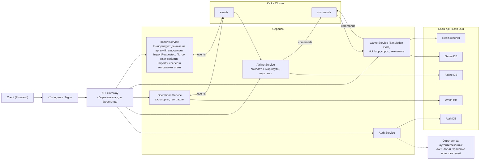

# AirlineSim

## Развёртывание через Docker Compose

Корневой [compose.yaml](compose.yaml) запускает веб-интерфейс со всеми микрофронтендами, BFF, шесть Go-сервисов, пять баз PostgreSQL (включая PostGIS), Kafka и справочник API. Все контейнеры подключены к внешней сети `intranet`. Порты хоста не публикуются.

1. Скопируйте `.env.example` в `.env`. Укажите адрес сайта в `AIRLINESIM_PUBLIC_URL` (с протоколом, без пути), email и пароль первого админа, пять паролей БД и `KAFKA_CLUSTER_ID`. Команды генерации указаны в шаблоне. Адрес сайта задаётся при сборке веб-интерфейса.
2. Создайте JWT-ключи один раз перед первым запуском. Закрытый ключ хранится в каталоге с доступом только для владельца. Контейнер авторизации читает его под собственным пользователем.

   ```sh
   (
     set -eu
     jwt_dir=${JWT_KEYS_DIR:-./.airlinesim-secrets}
     mkdir -p -m 700 "$jwt_dir"
     chmod 700 "$jwt_dir"
     if [ ! -e "$jwt_dir/private_key.pem" ]; then
       openssl genpkey -algorithm RSA -pkeyopt rsa_keygen_bits:2048 -out "$jwt_dir/private_key.pem"
     fi
     openssl pkey -in "$jwt_dir/private_key.pem" -pubout -out "$jwt_dir/public_key.pem"
     chmod 644 "$jwt_dir/private_key.pem" "$jwt_dir/public_key.pem"
   )
   ```

3. Подключите обратный прокси к `intranet` и направьте домен сайта на `http://airlinesim-web:80`. Передавайте исходный заголовок `Host` и разрешите WebSocket Upgrade. Справочник API доступен прокси по `http://airlinesim-api-reference:8080`.
4. Запустите из корня репозитория. Если сети ещё нет, предварительно выполните `docker network create intranet`.

   ```sh
   docker compose config --quiet
   docker compose up --build -d --wait
   docker compose ps
   ```

PostGIS использует образ для `linux/amd64`. После первого запуска импортируйте справочники стран, регионов и аэропортов через админку. Импорту нужен доступ к внешним источникам. Из контейнера в `intranet` можно проверить веб-вход и BFF по адресу `http://airlinesim-web/bff/health`. В сети `intranet` должны быть только доверенные контейнеры, поскольку через неё доступны внутренние gRPC-сервисы и Kafka.

Корневой Compose создаёт свои тома для PostgreSQL, Kafka и BFF. При переносе с предыдущего стенда спланируйте перенос данных до переключения прокси. Пароль первого администратора применяется при создании аккаунта.

### Komodo

Храните JWT-ключи на сервере Docker в постоянном каталоге вне Git-клона. Укажите его абсолютный путь в переменной `JWT_KEYS_DIR` в настройках Environment стека, например `/srv/airlinesim/secrets`. Задайте тот же `JWT_KEYS_DIR` в оболочке сервера перед выполнением шага генерации ключей. Если Komodo Periphery запущен в контейнере, каталог должен быть доступен по тому же абсолютному пути внутри Periphery и на сервере Docker. Если стенд уже выпускал токены, перенесите существующую пару ключей в этот каталог.

Добавьте `kafka-init` в **Config → Advanced → Ignore Services** в интерфейсе Komodo. При управлении стеком через TOML укажите `ignore_services = ["kafka-init"]` в `[stack.config]`. Контейнер создаёт топики и штатно завершается с кодом 0. Зависимые сервисы ждут его успешного завершения.

---

## Architecture diagram


